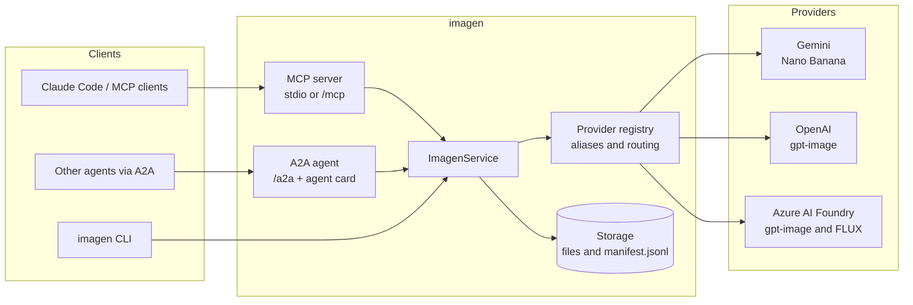

<div align="center">

# imagen

**A local image-generation hub for AI coding agents.**
One server. Gemini *Nano Banana*, OpenAI *gpt-image*, and Azure AI Foundry *FLUX*. Exposed over **MCP** and **A2A**.

[](https://github.com/tawanike/imagen/actions/workflows/ci.yml)
[](LICENSE)
[](package.json)
[](CONTRIBUTING.md)
[](https://github.com/tawanike/imagen/labels/good%20first%20issue)

</div>

Think of it as a self-hosted, bring-your-own-keys alternative to a hosted creative studio, built for the
moment your coding agent says *"I need a hero image / app icon / sprite / mockup for this"*.
Register it once with Claude Code (or any MCP client), and every project you open can generate
assets straight into its own folders.

```text
> Generate a 16:9 hero image for the landing page: warm morning light, a kitchen scale on
> a marble counter, photographic. Save it to public/hero.png.

● imagen › generate_image  model=gemini/gemini-nano-banana-2.1  aspect_ratio=16:9
  ✔ wrote public/hero.png (1.4 MB, 9.8 s)
```

## Contents

- [Why imagen?](#why-imagen)
- [Features](#features)
- [How it works](#how-it-works)
- [Quick start](#quick-start)
- [Configuration](#configuration)
- [Providers and models](#providers-and-models)
- [Use it from your tools](#use-it-from-your-tools)
- [MCP tool reference](#mcp-tool-reference)
- [A2A guide](#a2a-guide)
- [CLI reference](#cli-reference)
- [Recipes](#recipes)
- [Security](#security)
- [Project status](#project-status)
- [Roadmap](#roadmap)
- [Contributing](#contributing)
- [License](#license)

## Why imagen?

Every image model has its own SDK, auth scheme, size vocabulary and response shape. Agents shouldn't
care. imagen gives them **one small, consistent interface** and handles the differences:

- **One interface, many models.** Switch from Nano Banana to gpt-image to FLUX by changing a string.
- **Files, not blobs.** Images are written to disk (any folder you choose) and the agent gets back
  paths. No megabytes of base64 flooding the context window unless you ask for it.
- **Bring your own keys.** Runs on your machine. Your keys stay in your environment and talk straight
  to the providers.
- **Two protocols.** [MCP](https://modelcontextprotocol.io) for tool-using assistants like Claude Code,
  [A2A](https://a2a-protocol.org) for agent-to-agent delegation.
- **Small and hackable.** A compact TypeScript codebase. Adding a provider is one file.

## Features

- Text-to-image and **image editing** with reference images (style transfer, multi-image composition)
- **Gemini**: Nano Banana 2.1, Pro, 2, 2 Lite, and the legacy model, via the Interactions API
- **OpenAI**: gpt-image-2, 1.5, 1, 1-mini, including transparent backgrounds on models that support them
- **Azure AI Foundry**: gpt-image deployments through the Image API and FLUX.2 / FLUX 1.1 / Kontext
  through the Black Forest Labs API, with seed, guidance and steps passthrough
- Model aliases (`nano-banana`, `gpt-image`, ...) and a configurable default model
- Generate `n` images per call, choose aspect ratio, size, quality, format and seed
- Output manifest (`manifest.jsonl`) so agents and humans can find past generations
- MCP over **stdio** (per-user) or **Streamable HTTP** (shared daemon)
- A2A **v1.0** agent card and JSON-RPC endpoint, with v0.3 compatibility
- Loopback-only guard against DNS rebinding and cross-site requests
- Friendly CLI for use outside an agent

## How it works



Every front end calls the same `ImagenService`, so a feature added once shows up in MCP, A2A and the CLI.

## Quick start

**Requirements:** Node.js 22+, [pnpm](https://pnpm.io) 10+, and an API key for at least one provider.

```bash
git clone https://github.com/tawanike/imagen.git
cd imagen
pnpm install
pnpm build

# Put your keys in a private, shared location (never in the repo):
mkdir -p ~/.imagen && cp .env.example ~/.imagen/.env
$EDITOR ~/.imagen/.env

node dist/index.js models      # shows which providers are configured
node dist/index.js generate "flat vector icon of a smart kitchen scale, teal on white" -m nano-banana -a 1:1
```

Then register it with Claude Code:

```bash
claude mcp add imagen --scope user -- node "$(pwd)/dist/index.js" mcp
```

Restart your Claude Code session and ask it to generate an image.

## Configuration

imagen reads environment variables, and also loads env files from (first match wins per variable,
real environment variables always take priority):

1. `$IMAGEN_ENV_FILE`
2. `./.env` in the current working directory
3. `~/.imagen/.env`

| Variable | Default | Description |
| --- | --- | --- |
| `GEMINI_API_KEY` / `GOOGLE_API_KEY` | | Enables the `gemini` provider. Get a key at [Google AI Studio](https://aistudio.google.com/apikey). |
| `GEMINI_USE_GENERATE_CONTENT` | off | Set to `1` to use the classic `generateContent` API instead of the Interactions API. |
| `OPENAI_API_KEY` | | Enables the `openai` provider. |
| `OPENAI_BASE_URL` | | Optional OpenAI-compatible base URL. |
| `AZURE_FOUNDRY_ENDPOINT` | | Resource endpoint, e.g. `https://my-resource.services.ai.azure.com`. |
| `AZURE_FOUNDRY_API_KEY` | | Key for the Foundry resource. |
| `AZURE_FOUNDRY_DEPLOYMENTS` | | Comma-separated deployment names, e.g. `gpt-image-1.5,FLUX.2-pro,FLUX-1.1-pro`. Append `:bfl` or `:openai` to force a route. |
| `AZURE_FOUNDRY_API_VERSION` | `preview` | API version query parameter. |
| `IMAGEN_DEFAULT_MODEL` | first configured | Model used when a request omits one, e.g. `openai/gpt-image-2`. |
| `IMAGEN_OUTPUT_DIR` | `~/.imagen/images` | Default output folder. Tools can override it per call with `output_dir`. |
| `IMAGEN_HOST` | `127.0.0.1` | Bind address for `imagen serve`. See [Security](#security) before changing it. |
| `IMAGEN_PORT` | `4747` | Port for `imagen serve`. |
| `IMAGEN_PUBLIC_URL` | `http://HOST:PORT` | Base URL advertised in the A2A agent card and image URLs. |

## Providers and models

Model ids look like `provider/model`. You can also use a bare model id or an alias.

| Provider | Model id | Aliases | Notes |
| --- | --- | --- | --- |
| `gemini` | `gemini-nano-banana-2.1` | `nano-banana`, `banana` | Default workhorse. 1K/2K/4K, reference images, grounding. |
| `gemini` | `gemini-3-pro-image` | `nano-banana-pro` | Best for complex scenes and text rendering. |
| `gemini` | `gemini-3.1-flash-image` | `nano-banana-2` | Previous generation. |
| `gemini` | `gemini-3.1-flash-lite-image` | `banana-lite` | Fastest and cheapest, 1K only. |
| `gemini` | `gemini-2.5-flash-image` | | Legacy; uses `generateContent`. |
| `openai` | `gpt-image-2` | `gpt-image` | Current OpenAI flagship. |
| `openai` | `gpt-image-1.5`, `gpt-image-1` | | Support transparent backgrounds. |
| `openai` | `gpt-image-1-mini` | `gpt-image-mini` | Cheap drafts. |
| `azure` | your deployment names | | `gpt-image-*` use the Image API. `FLUX.2-*` use the Black Forest Labs route. |

Model availability and names change quickly. If a vendor renames a model, pass the new id directly
(`gemini/<new-id>`) or [open a PR](CONTRIBUTING.md) to add it to the catalog.

**Parameter mapping** (so you know what to expect from each backend):

| Parameter | Gemini | OpenAI | Azure (gpt-image) | Azure (FLUX.2 / BFL) |
| --- | --- | --- | --- | --- |
| `aspect_ratio` | native | mapped to 1024x1024 / 1536x1024 / 1024x1536 | same as OpenAI | mapped to width x height at about 1 MP |
| `size` | `512` `1K` `2K` `4K` or `WxH` bucketed | `WxH` or `auto` | `WxH` or `auto` | `WxH` |
| `quality` | mapped to thinking level | `low` `medium` `high` `auto` | same | ignored |
| `seed` | ignored | ignored | ignored | passed through |
| `background: transparent` | not supported | gpt-image-1 / 1.5 only | gpt-image-1 / 1.5 only | not supported |
| `reference_images` | yes | yes (edit endpoint) | yes | yes (`input_image`, `input_image_2`, ...) |
| `extra` | `googleSearch`, `previousInteractionId`, `thinkingLevel`, `imageSize` | merged into request | merged into request | merged into request (`guidance`, `steps`, ...) |

## Use it from your tools

### Claude Code

stdio (simplest; one process per session, nothing to keep running):

```bash
claude mcp add imagen --scope user -- node /absolute/path/to/imagen/dist/index.js mcp
```

Shared HTTP daemon (also serves A2A; start it once and reuse across sessions):

```bash
node dist/index.js serve                      # http://127.0.0.1:4747
claude mcp add --transport http imagen http://127.0.0.1:4747/mcp
```

To share the setup with a team, commit a project `.mcp.json` (see [`examples/mcp.json`](examples/mcp.json)).
Keep keys in `~/.imagen/.env`, not in that file.

### Other MCP clients

Anything that speaks MCP works. Point it at the stdio command
(`node /path/to/dist/index.js mcp`) or the HTTP URL (`http://127.0.0.1:4747/mcp`). The JSON shape for
most clients is the same as [`examples/mcp.json`](examples/mcp.json).

### Prompts that work well

> *Use imagen to make three logo options for "Fennel & Co", flat vector, transparent background.
> Save them in `assets/brand/`.*

> *Edit `public/hero.png` with imagen: same composition, but golden-hour lighting. Keep the original too.*

## MCP tool reference

| Tool | Description |
| --- | --- |
| `generate_image` | Text-to-image. Optional `reference_images` for guided generation. |
| `edit_image` | Edit or combine existing images; `reference_images` required. |
| `list_models` | Providers, model ids, aliases, and which providers are configured. |
| `list_recent_images` | Newest entries from the output manifest. |

`generate_image` / `edit_image` parameters:

| Parameter | Type | Description |
| --- | --- | --- |
| `prompt` | string, required | Describe subject, style, composition, lighting and any text to render. |
| `model` | string | `provider/model`, bare id or alias. Defaults to `IMAGEN_DEFAULT_MODEL`. |
| `n` | integer 1-8 | Number of images. |
| `aspect_ratio` | string | `1:1`, `16:9`, `9:16`, `4:3`, `3:2`, `21:9`, ... |
| `size` | string | `1024x1024`, `1536x1024`, `2K`, ... Overrides `aspect_ratio` where applicable. |
| `quality` | `low` `medium` `high` `auto` | Provider-mapped quality hint. |
| `seed` | integer | Reproducibility where supported (FLUX). |
| `output_format` | `png` `jpeg` `webp` | File format. |
| `background` | `transparent` `opaque` `auto` | Transparent backgrounds where supported. |
| `output_dir` | string | Folder to write into, e.g. `./public/assets`. |
| `filename` | string | Base filename without extension. |
| `reference_images` | string[] | Local paths, `file://`, `http(s)://` or `data:` URLs. |
| `return_image` | boolean | Also return image bytes inline as MCP image content. |
| `extra` | object | Provider-specific passthrough. |

The result is a JSON summary (model, timing, files with paths and sizes) plus a `resource_link` per file.

## A2A guide

Run `node dist/index.js serve`, then:

| Endpoint | URL |
| --- | --- |
| Agent card | `http://127.0.0.1:4747/.well-known/agent-card.json` |
| JSON-RPC | `http://127.0.0.1:4747/a2a` |
| Generated files | `http://127.0.0.1:4747/images/<file>` |
| Health | `http://127.0.0.1:4747/health` |

A request message may contain:

- **text** parts: the prompt
- one **data** part (`application/json`) with parameters: `model`, `n`, `aspectRatio`, `size`, `quality`,
  `seed`, `outputFormat`, `background`, `outputDir`, `filename`, `extra`
- **file** parts (raw bytes or URLs) with an `image/*` media type: reference images

The task moves `submitted → working → completed` (or `failed`, or `input-required` when the prompt is
empty) and finishes with an `images` artifact. Each image appears as raw bytes and as a URL under
`/images/`, alongside a `result.json` data part with paths and timing.

```bash
curl -s -X POST http://127.0.0.1:4747/a2a \
  -H 'Content-Type: application/json' -H 'A2A-Version: 1.0' \
  -d '{
    "jsonrpc": "2.0", "id": 1, "method": "SendMessage",
    "params": { "message": {
      "messageId": "m1", "role": "ROLE_USER",
      "parts": [
        { "text": "a red fox in an autumn forest, watercolor" },
        { "data": { "model": "nano-banana", "aspectRatio": "16:9" } }
      ]
    } }
  }'
```

Clients using the older v0.3 wire format (`message/send`) are accepted too.

## CLI reference

Examples below write `imagen` for short. From a clone, that is `node dist/index.js`, or run `pnpm link --global` to get a real `imagen` command.

```text
imagen mcp                         MCP server over stdio
imagen serve [-p 4747] [-H host]   HTTP server: /mcp, /a2a, /images
imagen models                      Providers, models and configuration status
imagen generate <prompt...>        Generate from the command line

generate options:
  -m, --model <model>      model id or alias
  -n, --count <n>          number of images
  -a, --aspect <ratio>     e.g. 16:9
  -s, --size <size>        e.g. 1024x1024 or 2K
  -q, --quality <q>        low | medium | high | auto
  -f, --format <fmt>       png | jpeg | webp
  -o, --out <dir>          output directory
      --name <base>        base filename
  -r, --ref <path...>      reference image path(s) or URL(s)
      --seed <n>           seed (FLUX)
      --transparent        transparent background (gpt-image-1 / 1.5)
      --json               print machine-readable JSON
```

## Recipes

```bash
# App icon with transparent background
imagen generate "minimal flat icon of a kitchen scale, teal gradient" -m openai/gpt-image-1.5 --transparent -s 1024x1024 -o ./assets/icons

# Hero banner, high quality
imagen generate "sunlit marble kitchen counter, photographic, shallow depth of field" -m nano-banana-pro -a 21:9 -s 2K -q high

# Restyle an existing image
imagen generate "same scene as a watercolor illustration" -r ./public/hero.png -m nano-banana

# Reproducible FLUX output
imagen generate "isometric tiny cafe, pastel palette" -m azure/FLUX.2-pro --seed 42

# Four quick variations to pick from
imagen generate "logo mark for a bakery called Fennel" -m gpt-image-mini -n 4 -o ./assets/logo-options
```

## Security

imagen spends **your** API credits and writes to **your** disk, so treat it accordingly.

- **Local by default.** `imagen serve` binds to `127.0.0.1`. It has no authentication.
- **Rebinding and cross-site protection.** While bound to a loopback address, requests whose `Host` or
  `Origin` header is not a local name are rejected with `403`, so a web page you visit cannot drive the
  server.
- **Do not expose it.** If you set `IMAGEN_HOST=0.0.0.0` the guard is disabled and imagen prints a warning.
  Put it behind an authenticating reverse proxy or a VPN first.
- **Keys stay in the environment.** They are read from env vars or env files and sent only to the
  provider you selected. They are never written to output files or the manifest.
- **Arbitrary paths.** `output_dir` and `reference_images` let the caller read and write local paths. That
  is intended for a trusted local agent; do not let untrusted callers reach the HTTP server.
- **Generated content.** Images carry whatever provenance marks the vendor adds (for example Gemini's
  SynthID watermark). You are responsible for how you use outputs and for each provider's terms.

Found a vulnerability? Please follow [SECURITY.md](SECURITY.md) rather than opening a public issue.

## Project status

imagen is **early (v0.x)**. The protocol layers (MCP over stdio and HTTP, A2A v1.0 and v0.3), model
resolution, storage and the security guard are covered by automated tests. The provider adapters are
written against the vendors' published API documentation, but **real-account verification is still
being collected**. This is the most useful thing a new contributor can do.

| Area | Automated tests | Verified against live API |
| --- | --- | --- |
| MCP stdio / HTTP, A2A, CLI | Yes | n/a |
| Model resolution, storage, guard | Yes | n/a |
| Gemini (Interactions API) | Not yet (see roadmap) | Help wanted |
| OpenAI gpt-image | Request/response shape, via a local mock server | Help wanted |
| Azure gpt-image (Image API) | Request/response shape, via a local mock server | Help wanted |
| Azure FLUX.2 (Black Forest Labs route) | Request/response shape, via a local mock server | Help wanted |

If you run a provider with your own key, please [report what worked and what didn't](https://github.com/tawanike/imagen/issues/new?template=provider_report.yml).
Redact keys and endpoints, and include the response shape for failures.

## Roadmap

Good places to jump in (see the [issue tracker](https://github.com/tawanike/imagen/issues) for details):

- [ ] Live-verify and harden each provider adapter
- [ ] Microsoft Entra ID auth for Azure Foundry
- [ ] Mock-server tests for the Gemini adapter (OpenAI and Azure already have them)
- [ ] Streaming progress and partial images over MCP and A2A
- [ ] Optional bearer-token auth for the HTTP server
- [ ] Vertex AI backend for Gemini and Imagen models
- [ ] Image post-processing tools: resize, convert, background removal, sprite sheets
- [ ] Prompt presets and per-project style guides (for brand-consistent assets)
- [ ] Cost estimates in `list_models` and the manifest
- [ ] More providers: Stability, Replicate, fal, local ComfyUI
- [ ] Publish to npm so `npx imagen mcp` just works
- [ ] Docker image

## Contributing

Contributions of every size are welcome: bug reports, provider test reports, docs, new providers, tests.

1. Read [CONTRIBUTING.md](CONTRIBUTING.md). It covers setup, the project layout and how to add a provider.
2. Pick an issue labelled [`good first issue`](https://github.com/tawanike/imagen/labels/good%20first%20issue)
   or [`help wanted`](https://github.com/tawanike/imagen/labels/help%20wanted), or open one describing what you'd like to do.
3. Run `pnpm check` (typecheck, tests, build) before you open a pull request.

Be kind. Everyone here is following the [Code of Conduct](CODE_OF_CONDUCT.md).

```bash
pnpm install
pnpm dev models      # run from source
pnpm check           # typecheck + tests + build
```

## License

[MIT](LICENSE). Third-party model outputs are subject to each provider's terms.
